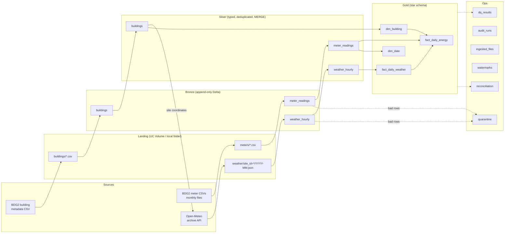

# Smart Building Energy and Supply Lakehouse

A medallion (bronze / silver / gold) lakehouse built with PySpark, Delta Lake and SQL. It ingests
hourly smart-building electricity readings (files) and historical weather (API), cleans and
upserts them incrementally, and publishes a Power BI-ready star schema with energy per m²,
weather-normalised consumption and anomaly flags. Data quality, reconciliation, audit and restore
controls are built in, and the same code is packaged to run as a Databricks job.

> **Where this has run.** The full pipeline has run on **local open-source Spark 4.0 + Delta Lake 4.0**
> (in Docker) on the real data subset; see [Results](#results). It has **not yet run on
> Databricks**: the Unity Catalog, Volume, Asset Bundle, job, alert and lineage parts are written
> but unverified until someone deploys them to a workspace ([what is and isn't verified](#what-is-verified)).

## Architecture



Lineage in words: every bronze row carries `_source_file`, `_batch_id` and `_ingested_at`; silver
rows carry `_batch_id` (the run that last wrote them) and `_source_ingested_at` (which bronze load
they came from); every step writes a row to `ops.audit_runs`. On Databricks, Unity Catalog also
records table-level lineage automatically for jobs that read and write UC tables (unverified here).

### Run order (`src/sbl/conf/pipeline.yml`)

| Stage | What it does |
|---|---|
| `reference_data` | bronze + silver for building metadata (the weather extract needs site coordinates) |
| `extract_weather` | one Open-Meteo request per site and month into landing; existing months are skipped |
| `bronze` | meter and weather files into bronze, bad rows to `ops.quarantine` |
| `silver` | incremental MERGE of meters and weather |
| `gold` | rebuild the four gold tables |
| `quality` | rules from `quality.yml` into `ops.dq_results`; `error` rules fail the run |
| `reconcile` | counts and kWh totals from source files to gold, into `ops.reconciliation` |

## Design

**Configuration, not code.** Sources, columns, types, keys, constraints, quality rules, tolerances,
paths and run order are YAML in [`src/sbl/conf/`](src/sbl/conf). Adding a new CSV source plus its
silver table is two YAML entries; no Python changes. Gold is the exception: its business logic is
code ([`gold.py`](src/sbl/gold.py)), with parameters and descriptions in `gold.yml`.
`sbl-validate-config` checks all of it and runs in CI.

**Bronze** ([`bronze.py`](src/sbl/bronze.py)): append-only, all values kept as raw strings plus
lineage columns. Files already listed in `ops.ingested_files` are skipped. Each configured column is
checked: missing required values, values that cannot be cast and rows Spark cannot parse go to
`ops.quarantine` with a reason and the raw record. **Schema drift:** a configured column missing
from a file fails the batch; a new column is added to the table (`mergeSchema`) and logged, or fails
the batch if the source's policy is `fail`.

**Silver** ([`silver.py`](src/sbl/silver.py)): reads only bronze rows newer than the table's
watermark, casts with `try_cast` / `try_to_timestamp` (Spark 4 and Databricks serverless run in ANSI
mode, where a plain bad cast fails the job), keeps the latest row per business key, and `MERGE`s
on that key. Delta `CHECK` constraints (e.g. `reading_kwh >= 0`) reject bad writes.

**Gold** ([`gold.py`](src/sbl/gold.py)): daily energy per building, kWh/m², heating and cooling
degree days (base 18 °C), and a per-building linear model `kWh ~ HDD + CDD` fitted on complete days
(`applyInPandas` + NumPy least squares). `weather_normalised_ratio` = actual / expected, and a day
is an anomaly when its residual z-score is above 3. Days with under 90% non-zero hours are flagged
`incomplete` and not modelled.

**Controls:** `ops.audit_runs` (every step, success or failure), `ops.dq_results` (rule results),
`ops.reconciliation` (cross-layer checks), Delta time travel + `RESTORE`
([`restore_demo.py`](src/sbl/restore_demo.py)), monitoring SQL
([`monitoring.sql`](src/sbl/sql/monitoring.sql)). See the [runbook](docs/runbook.md).

**One codebase, two environments.** [`lakehouse.py`](src/sbl/lakehouse.py) resolves table names:
`smart_building.silver.meter_readings` on Databricks, a Delta folder locally. Raw files land in a
**Unity Catalog Volume** on Databricks. *Databricks Free Edition cannot attach Azure Data Lake
Storage, so this project uses a Volume where a production Azure setup would use ADLS.*

## Data sources

| Source | Licence | Used |
|---|---|---|
| [Building Data Genome Project 2](https://github.com/buds-lab/building-data-genome-project-2): hourly electricity + metadata | CC BY-SA 4.0 | 8 buildings at 2 sites (Panther, Orlando: cooling-driven; Lamb, Cardiff: heating-driven), 2016-2017 |
| [Open-Meteo Historical Weather API](https://open-meteo.com/) | CC BY 4.0, free tier non-commercial | hourly temperature and humidity for both sites |

Details, file sizes and checksums: [docs/data-sources.md](docs/data-sources.md). Source C (supply
chain) was not added.

## How to run

### Locally (Docker)

PySpark does not run on native Windows without extra Hadoop binaries, so everything runs in a
Linux container with Python 3.11 and Java 17.

```bash
python scripts/prepare_bdg2_subset.py          # download BDG2 (174 MB) and cut the subset into data/landing
docker build -f Dockerfile.test -t sbl-test .
docker run --rm sbl-test                        # lint + config check + all tests
```

Run the pipeline on the real data (a named Docker volume holds the lakehouse between runs):

```bash
docker run -d --name sbl -v sbl-data:/app/data sbl-test sleep infinity
docker cp data/landing sbl:/app/data/
docker exec sbl sbl-run --env local --stage all
docker exec sbl python -m sbl.restore_demo --env local
docker exec sbl python -m sbl.report --env local --out docs/run-results.md
docker cp sbl:/app/docs/run-results.md docs/run-results.md
```

### On Databricks (not yet verified)

1. Free Edition workspace; run [`setup/00_workspace_setup.sql`](setup/00_workspace_setup.sql) in the SQL editor.
2. Install and log in to the CLI: `winget install Databricks.DatabricksCLI`, then
   `databricks auth login --host <workspace-url>`.
3. Upload the landing files to the Volume:
   `databricks fs cp -r data/landing dbfs:/Volumes/smart_building/bronze/landing`
4. Deploy and run the job: `databricks bundle validate`, `databricks bundle deploy`,
   `databricks bundle run lakehouse_pipeline`. If you could not create the `smart_building`
   catalog, add `--var catalog=workspace` to each command (and use that catalog in step 3).
5. Monitoring: `python -m sbl.report --env databricks --render-sql` prints the dashboard / alert SQL.

## How to test

| Suite | File | What it proves |
|---|---|---|
| Config | `tests/test_config.py` | every env's config is valid; the validator catches broken settings |
| Bronze | `tests/test_bronze.py` | lineage columns, quarantine reasons, malformed rows, re-run skips files, schema drift add / fail / missing column |
| Parsers | `tests/test_parsers.py` | Open-Meteo JSON explode, corrupt JSON quarantined, ANSI-safe casts |
| Silver | `tests/test_silver.py` | dedup keeps latest, MERGE insert + update, watermark, idempotent re-run and full reprocess, CHECK constraint |
| Gold | `tests/test_gold.py` | dim_date, degree days, completeness, weather model recovers known coefficients and flags a spike, NaN guard |
| Quality | `tests/test_quality.py` | every rule type, error vs warn, results logged before failing |
| Extract | `tests/test_extract.py` | month ranges, URL, retries, skip existing (no network) |
| Integration | `tests/test_integration.py` | all stages on a tiny dataset vs hand-computed gold; reconciliation passes, then catches a deleted row; re-runs are idempotent; restore demo |

## Results

From the run on 2026-10-21 (local Spark 4.0.1 + Delta 4.0.1 in Docker, real data). Every number
below is in [docs/run-results.md](docs/run-results.md), which `python -m sbl.report` generated
from the tables.

**Ingestion (run 1)**

| | Rows |
|---|---|
| Meter readings landed (24 monthly files) | 140,352 |
| → bronze | 140,312 |
| → quarantined (`meter_reading: missing`, 3 files) | 40 |
| Weather hours from Open-Meteo (48 API calls: 2 sites × 24 months) | 35,088 |
| Buildings | 8 |
| Silver meter readings / weather hours | 140,312 / 35,088 |
| Gold `fact_daily_energy` (8 buildings × 731 days) | 5,848 |
| Gold `fact_daily_weather` / `dim_date` / `dim_building` | 1,462 / 731 / 8 |

**Tables:** 16 Delta tables (3 bronze, 3 silver, 4 gold, 6 ops).

**Controls**
- Data quality: **19 of 19 rules passed** (16 error, 3 warn). Of note: 9.6% of hourly readings are
  exactly 0 (warn threshold 25%); 9.8% of building-days are `incomplete`, all at Panther.
- Reconciliation: **10 of 10 checks passed**. Total silver kWh = gold kWh = 13,552,132.797
  (relative difference 1.7e-14, floating-point rounding).
- Idempotency: run 2 (nothing new) ingested 0 files and merged 0 rows. Run 3 reprocessed all silver
  from scratch (`--reset-watermark`): MERGE updated 140,312 + 35,088 rows and **inserted 0**.
  Row counts were unchanged.
- Restore demo: a bad MERGE multiplied Lamb_education_Domitila's January 2017 readings by 1000
  (744 rows), raising the table total from 13,552,132.797 to 43,670,276.405 kWh. The
  `reading_kwh_range` rule flagged 385 of those rows: the other 359 were still under its
  10,000 kWh ceiling after ×1000, which shows the limit of a fixed range rule. `RESTORE TABLE …
  TO VERSION AS OF 4` returned the table to exactly 140,312 rows and 13,552,132.797 kWh.
- Audit: 35 step records across 7 runs, 0 failed steps.

**Tests:** 56 passed (unit, integration and reconciliation), both in the Docker image and on
[GitHub Actions](https://github.com/maniktomar/smart-building-lakehouse/actions) (Ubuntu, Python 3.11, Java 17).

**Weather model, as a sanity check (not a finding):** 7 anomaly days were flagged, all at
Panther_education_Annetta. Panther buildings have 143 incomplete days each, consistent with the
long runs of zero readings in the source.

## What is verified

| Claim | Status |
|---|---|
| Pipeline end to end on real data (local Spark + Delta) | ✅ ran, see Results |
| Unit, integration and reconciliation tests | ✅ ran locally in Docker |
| Delta MERGE, CHECK constraints, time travel, RESTORE | ✅ ran (open-source Delta 4.0) |
| GitHub Actions CI (lint, config validation, 56 tests) | ✅ green on PR #1 and on `main` |
| Tag-triggered release (tests, then wheel) | ✅ [v0.1.0](https://github.com/maniktomar/smart-building-lakehouse/releases/tag/v0.1.0) |
| Open-Meteo API ingestion | ✅ ran (48 real API calls) |
| Unity Catalog tables, Volume, serverless job, email on failure | ❌ not run: needs a Databricks workspace |
| Databricks Asset Bundle deploy | ❌ not run (`databricks.yml` written, never validated against a workspace) |
| Unity Catalog lineage, SQL dashboard and alert | ❌ not run |
| Azure DevOps pipeline | ❌ not run (`azure-pipelines.yml` written; needs an org with a parallelism grant) |
| Power BI report | ❌ not built ([guide](docs/power-bi.md) only) |

## Limitations and simplifications

- **Not production scale.** 8 buildings and about 140k hourly rows. Nothing here measures performance.
- **Gold is fully rebuilt** each run; a large gold layer would MERGE only affected dates.
- **Timestamps are site-local wall-clock time**, stored as-is. BDG2 has exactly 24 readings per day
  (no daylight-saving gaps), while Open-Meteo local time does shift; around the two DST changes a
  year, weather and meter hours can be one hour apart. Daily aggregates are barely affected.
- **Weather model is deliberately simple**: daily-mean degree days at a fixed 18 °C base, ordinary
  least squares on the same days it scores (no train/test split), z-score threshold 3.
- **BDG2 site coordinates are approximate** (sites are anonymised), so weather is for the nearby
  city, not the exact building. BDG2 site `Wolf` lists longitude +6.26 with timezone Europe/Dublin,
  which looks like a sign error; that site is not used.
- **Bronze crash window**: a crash between writing rows and recording the file can load a file twice
  into bronze; silver's MERGE deduplicates it and reconciliation would flag the bronze surplus.
- **Zero readings**: about a fifth of Panther's hours are exactly 0, typical of meter outages. They
  are kept (they are what the source says) and handled through `completeness_pct` and the
  `incomplete` flag, not deleted.
- **The landing files are produced by a script** (`prepare_bdg2_subset.py`) that plays the source
  system: it only subsets and reshapes BDG2 from wide to long, and does no cleaning.

## Repository layout

| Path | Purpose |
|---|---|
| `src/sbl/conf/` | YAML config: environments, sources, silver tables, gold docs, quality rules, run order |
| `src/sbl/` | pipeline package: `bronze`, `silver`, `gold`, `quality`, `reconcile`, `extract`, `run` |
| `src/sbl/sql/monitoring.sql` | monitoring queries (dashboard / alert) |
| `scripts/prepare_bdg2_subset.py` | download BDG2 and cut the subset |
| `setup/00_workspace_setup.sql` | Unity Catalog catalog, schemas, Volume |
| `databricks.yml` | Asset Bundle: wheel + 7-task serverless job with failure email |
| `.github/workflows/` | CI (lint, config check, tests) and release (wheel on version tags) |
| `azure-pipelines.yml` | Azure DevOps equivalent (not run) |
| `docs/` | data sources, runbook, data dictionary, Power BI guide, free-tier check, run results |
